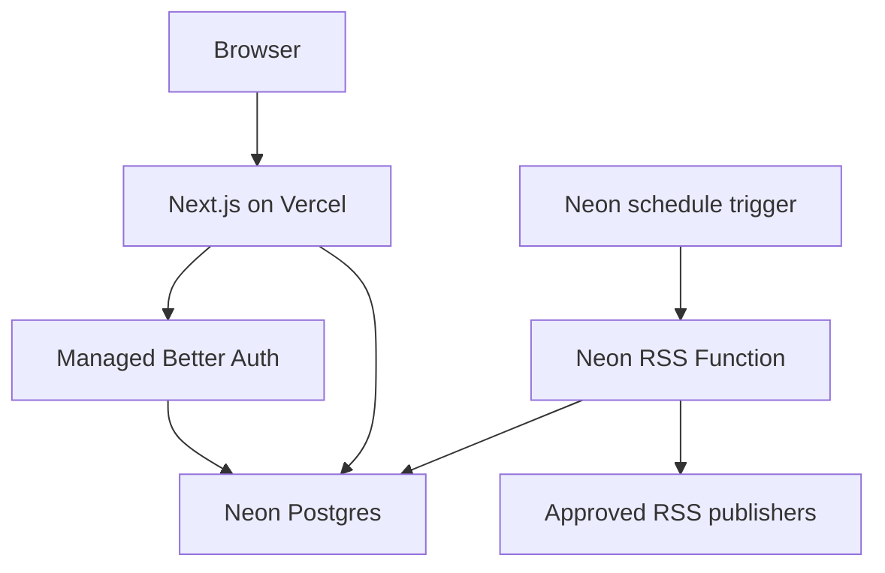

# Build a community news reader with Neon

Three-part tutorial production handbook · researched October 2, 2026

This is an implementation and recording plan with core code, narration, demonstrations, and acceptance criteria. The code is a proposed implementation, not an account-tested repository. Rehearse it against a real Neon project, pin the resulting package versions, and publish the lockfile before recording.

## 1. The central promise—and the deployment correction

Build a shared news reader: anyone can browse articles; registered members can comment; signed-in members can add feeds from approved publishers; a scheduled Neon Function imports new articles. Everyone using this installation sees the same articles and discussions. There are no private user feeds, votes, nested replies, or separate communities in this series.

The product message is supported: Neon is now a backend platform around Postgres, with Managed Better Auth, Functions, Object Storage, and AI Gateway. We use database, authentication, and Functions; the others deserve a brief mention, not extra features.

**The deployment wording needs adjustment.** Neon's current [full backend Next.js quickstart](https://neon.com/docs/get-started/full-backend-quickstart) provisions a backend with `neon.ts` and `neon deploy`. It explicitly deploys Next.js to a separate App Router host, including Vercel, Netlify, or self-hosted Node. Neon Functions are for backend logic and are not intended to host the Next.js frontend. This is also explicit in [Neon's Functions announcement](https://neon.com/blog/neon-functions-backend-logic-next-to-your-data).

Use this sentence throughout:

> “Our backend is declared in neon.ts and deployed with neon deploy. Our Next.js app connects to that backend and runs on Vercel.”

If Neon expects a different, unreleased hosting workflow for this campaign, obtain that specific quickstart before changing this wording. The public docs do not establish native Next.js hosting.

Suggested titles:

1. **Build a News Reader with Next.js and Neon's Backend as Code**
2. **Add Managed Better Auth and Shared Comments with Neon**
3. **Import RSS Feeds with Scheduled Neon Functions**

## 2. Mirror the right quickstarts

Follow the [full backend quickstart](https://neon.com/docs/get-started/full-backend-quickstart), rather than an older guide that only connects Next.js to Postgres. Keep its scaffold → link → checkout → config → Drizzle → Server Component sequence. Replace its posts table with sources and articles. Omit its storage uploads and AI assistant. Replace its AI Function with the RSS Function in Part 3.

Follow the [Next.js auth API quickstart](https://neon.com/docs/auth/quick-start/nextjs-api-only) for `createNeonAuth`, the catch-all route, and sign-up/sign-in Server Actions. Enable the service through `auth: true` and `neon deploy` rather than making console provisioning the main workflow.

Follow [Schedule a function](https://neon.com/docs/compute/functions/triggers/schedule) and the [Function Triggers overview](https://neon.com/docs/compute/functions/triggers/overview) for the cron and request contract. Use `pg` with a reusable pool in the Function, as recommended by the full backend quickstart; one schedule example uses the HTTP driver, but the more specific Functions guidance recommends `pg`.

Current prerequisites from those docs:

- Next.js quickstart requires Node 20.19+. Use a supported Node 24 release for the recording workstation to align with the Functions runtime.
- Use AWS Ohio (`aws-us-east-2`) for the tutorial. The quickstart currently lists Ohio, N. Virginia, Frankfurt, and Singapore for Functions, Storage, and AI Gateway. Recheck availability before recording.
- Use the current `neon` CLI package. This series uses the `neon` command, not an old `neonctl` walkthrough.
- Top-level `functions`, `buckets`, and `aiGateway` config require `@neon/config` 1.6.0 or later. The older `preview` wrapper is deprecated. See [neon.ts reference](https://neon.com/docs/reference/neon-ts).
- Managed Better Auth provides familiar Better Auth APIs through `@neondatabase/auth`; it is not a tutorial about self-hosting a `betterAuth()` server with your own adapter. See [Managed Better Auth overview](https://neon.com/docs/auth/overview).

## 3. Series structure

| Episode | Viewer outcome | Main concept | Suggested edited length |
|---|---|---|---|
| 1 | Deployed reader with seeded articles and working detail pages | Backend as code; relational data; server rendering | 30–40 minutes |
| 2 | Two users can sign in and discuss the same article | Managed identity; authorization; shared data | 30–40 minutes |
| 3 | Members add sources; Neon imports on a schedule without duplicates | Scheduled execution; idempotency; observable ingestion | 35–45 minutes |

Every episode starts with the exact feature we will finish, implements it, then proves it. Use short conceptual pauses around code that expresses an important boundary. Move repetitive styling into the starter files or a fast edit.

The arc is **data → identity → automation**. Part 1 ends with a useful read-only application. Part 2 makes it social. Part 3 keeps it supplied with news.

## 4. Architecture and scope



Browser requests go to Next.js. Server Components query Postgres. Server Actions validate input, read the authenticated session, and mutate application tables. The browser never receives `DATABASE_URL`.

Auth requests use the Next.js auth route as a proxy to Neon’s managed service. The RSS Function receives scheduled HTTP POSTs from Neon and uses its automatically injected branch `DATABASE_URL`.

No Data API or RLS setup is needed for this server-only database access path. Authorization is enforced in server mutations. Adding auth does not automatically secure every query, and the application database connection must never be exposed as a browser credential.

Shared discussions appear on navigation or refresh. “Other users can see comments” does not promise live push updates. Explicitly demonstrate refresh in a second browser. Realtime can be a later tutorial.

### Product decisions

| Question | Series decision | Why |
|---|---|---|
| What is an article? | Feed metadata, title, plain-text excerpt, publisher URL | Makes the detail page a discussion page without republishing full articles |
| Who can read? | Anyone | The first video stays useful before auth |
| Who can comment? | Authenticated members | Simple, visible authorization boundary |
| Who can add feeds? | Authenticated members, approved publisher hosts | Delivers source management without making an unrestricted server fetch proxy |
| Who can manage sources? | Initial series: add and list only | Disabling/deleting can become an admin follow-up |
| Duplicate identity | `(source_id, external_key)` | Feed item IDs are generally only meaningful within their feed |
| Missing item GUID | Normalized article URL as fallback | Avoids treating every import as a new article |
| Updated feed items | First imported metadata wins | `DO NOTHING` preserves article IDs and attached comments |
| Sorting | Ingestion time descending, ID tie-breaker | Newly discovered, older-dated articles still become visible |
| Pagination | First 30 for the initial UI; keyset pagination extension | Bounded query from day one without adding a long UI segment |

The approved-host choice is a deliberate tutorial boundary. To accept arbitrary internet feeds later, add DNS/IP validation, block private/loopback/link-local targets and metadata services, and validate every redirect hop. A URL parser alone is not an SSRF defense. In the tutorial, store only HTTPS URLs on an explicit server-side hostname allowlist, reject custom ports, and reject redirects during fetching.

## 5. Repository plan

```text
neon.ts
drizzle.config.ts
lib/db/schema.ts
lib/db/client.ts
lib/news.ts
lib/auth/server.ts
lib/feed-policy.ts
app/page.tsx
app/articles/[id]/page.tsx
app/articles/actions.ts
app/articles/comment-form.tsx
app/auth/sign-up/page.tsx
app/auth/sign-in/page.tsx
app/auth/auth-form.tsx
app/auth/actions.ts
app/components/auth-navigation.tsx
app/layout.tsx
app/api/auth/[...path]/route.ts
app/sources/page.tsx
app/sources/actions.ts
app/sources/source-form.tsx
functions/rss.ts
functions/ingest.ts
drizzle/                         # generated migrations
scripts/seed.ts
fixtures/feed-v1.xml
fixtures/feed-v2.xml
.env.example                    # names and placeholders only
README.md
```

Use `part-1`, `part-2`, and `part-3` Git tags, plus an initial `starter` tag. Keep the article URLs and seeded IDs stable between episodes. Publish a per-episode README with the exact tag, setup commands, expected screen, troubleshooting, and timestamps. Avoid maintaining three unrelated copies of the application.

Suggested package scripts:

```json
{
  "dev": "next dev",
  "build": "next build",
  "start": "next start",
  "lint": "eslint .",
  "typecheck": "tsc --noEmit",
  "db:generate": "drizzle-kit generate",
  "db:migrate": "drizzle-kit migrate",
  "db:seed": "tsx scripts/seed.ts",
  "backend:plan": "neon config plan",
  "backend:deploy": "neon deploy"
}
```

Record package versions after the rehearsal; then use `npm ci` for reproducibility. The instructions below use `@latest` only for initial project setup.

## 6. Part 1: data and backend deployment

### Recording rundown and narration

| Time | On screen | Narration / teaching goal |
|---|---|---|
| 0:00–1:30 | Final app; click an article | “We’re building a news reader for a small community. We’ll collect articles from RSS feeds, sign in, and discuss them together. Today we’re building the data layer and the reader.” |
| 1:30–3:30 | Architecture graphic | “You might know Neon as serverless Postgres. It now provides more of the backend stack, including managed authentication and Functions. We’ll add those as the application needs them.” |
| 3:30–7:00 | Create app and Neon project | “Next.js runs our web application. Neon runs the backend services. These have separate deployment steps.” |
| 7:00–10:00 | `neon.ts`, plan, deploy | “This file describes the backend we want. neon deploy applies it to the branch linked to this directory. We can review this configuration alongside our application code.” |
| 10:00–17:00 | Schema and migration | “A source is a feed. An article belongs to a source. Keeping them separate avoids repeating publisher information and gives the importer somewhere to store fetch state later.” |
| 17:00–24:00 | List page and SQL/data layer | “This query runs in a Server Component. The browser gets the rendered page; it doesn’t get a database password.” |
| 24:00–29:00 | Detail page and missing article | “Our detail page is where the discussion will live. For now it shows an excerpt and links to the original publisher.” |
| 29:00–35:00 | Migrate target branch; host deployment | “neon deploy provisions Neon’s backend. It does not upload Next.js. We now deploy the web app and give its server the connection to the same database branch.” |
| 35:00–37:00 | Reload deployed list and detail | “We have real data and a deployed reader. Next we’ll use Neon’s managed Better Auth to give people identities and add comments.” |

### Commands

```bash
npm i -g neon
neon login
neon projects create --name community-news --region-id aws-us-east-2
npx create-next-app@latest community-news --typescript --tailwind --app --eslint --yes
cd community-news
neon link --no-config
neon checkout main
neon config init
npm install drizzle-orm @neondatabase/serverless server-only zod @next/env
npm install -D drizzle-kit tsx
```

Check that the scaffold uses root `app/` and `lib/` paths as shown; if it uses `src/`, move the examples there and update Drizzle paths. Keep the scaffolded branch policy. The compact policy below leaves existing/default settings alone and gives new non-default branches a seven-day TTL.

```ts
// neon.ts — Part 1
import { defineConfig } from '@neon/config/v1';

export default defineConfig({
  branch: (branch) => {
    if (!branch.isDefault && !branch.exists) return { ttl: '7d' };
    return {};
  },
});
```

```bash
neon config plan
neon deploy
```

Postgres already exists on a new project's default branch. Don't pretend this first deploy created an additional service. Use it to establish the workflow. Part 2 will visibly provision auth; Part 3 will deploy Function code and a trigger.

### Schema

Define `sources` and `articles` in Part 1. Add `comments` in Part 2. Add the source fetch-state columns in Part 3. The final schema below shows where all three parts end up.

```ts
// lib/db/schema.ts — final schema
import { sql } from 'drizzle-orm';
import {
  pgTable, uuid, text, boolean, timestamp, integer,
  uniqueIndex, index, check,
} from 'drizzle-orm/pg-core';

export const sources = pgTable('sources', {
  id: uuid('id').defaultRandom().primaryKey(),
  name: text('name').notNull(),
  feedUrl: text('feed_url').notNull(),
  enabled: boolean('enabled').notNull().default(true),
  createdAt: timestamp('created_at', { withTimezone: true }).defaultNow().notNull(),
  // Part 3
  addedBy: text('added_by'),
  etag: text('etag'),
  lastModified: text('last_modified'),
  lastCheckedAt: timestamp('last_checked_at', { withTimezone: true }),
  lastSuccessAt: timestamp('last_success_at', { withTimezone: true }),
  lastError: text('last_error'),
  consecutiveFailures: integer('consecutive_failures').notNull().default(0),
}, (t) => [uniqueIndex('sources_feed_url_unique').on(t.feedUrl)]);

export const articles = pgTable('articles', {
  id: uuid('id').defaultRandom().primaryKey(),
  sourceId: uuid('source_id').notNull().references(() => sources.id),
  externalKey: text('external_key').notNull(),
  title: text('title').notNull(),
  url: text('url').notNull(),
  excerpt: text('excerpt').notNull().default(''),
  publishedAt: timestamp('published_at', { withTimezone: true }),
  ingestedAt: timestamp('ingested_at', { withTimezone: true }).defaultNow().notNull(),
}, (t) => [
  uniqueIndex('articles_source_external_unique').on(t.sourceId, t.externalKey),
  index('articles_recent_idx').on(t.ingestedAt, t.id),
]);

export const comments = pgTable('comments', {
  id: uuid('id').defaultRandom().primaryKey(),
  articleId: uuid('article_id').notNull()
    .references(() => articles.id, { onDelete: 'cascade' }),
  authorId: text('author_id').notNull(),
  authorName: text('author_name').notNull(),
  body: text('body').notNull(),
  createdAt: timestamp('created_at', { withTimezone: true }).defaultNow().notNull(),
}, (t) => [
  index('comments_article_created_idx').on(t.articleId, t.createdAt, t.id),
  check('comments_body_length', sql`char_length(btrim(${t.body})) between 1 and 2000`),
]);
```

`authorId` is an opaque auth ID, stored as text without assuming UUID format. `authorName` is a session-derived display-name snapshot. This avoids having the tutorial declare or migrate Neon’s managed `neon_auth` tables. There is intentionally no foreign key into a managed table. Explain the tradeoff: deleting an auth account won't delete/anonymize these comments automatically, and later display-name changes won't update old comments. A public release needs an explicit account deletion and moderation policy.

Prefer tracked migrations across a three-part series:

```ts
// drizzle.config.ts
import { loadEnvConfig } from '@next/env';
import { defineConfig } from 'drizzle-kit';
loadEnvConfig(process.cwd());

export default defineConfig({
  schema: './lib/db/schema.ts',
  out: './drizzle',
  dialect: 'postgresql',
  dbCredentials: { url: process.env.DATABASE_URL! },
});
```

```bash
npm run db:generate
npm run db:migrate
```

The Neon quickstart uses `drizzle-kit push` for speed and explicitly recommends generated migrations for tracked changes. Here, the migration artifacts are useful teaching material. **neon deploy does not apply your application schema migrations.** Keep provisioning and schema commands visibly separate.

### Database client and queries

```ts
// lib/db/client.ts
import 'server-only';
import { neon } from '@neondatabase/serverless';
import { drizzle } from 'drizzle-orm/neon-http';
import * as schema from './schema';

export const db = drizzle(neon(process.env.DATABASE_URL!), { schema });
```

```ts
// lib/news.ts — Part 1
import 'server-only';
import { desc, eq } from 'drizzle-orm';
import { db } from './db/client';
import { articles, sources } from './db/schema';

export function listArticles() {
  return db.select({
    id: articles.id, title: articles.title, excerpt: articles.excerpt,
    sourceName: sources.name, publishedAt: articles.publishedAt,
  }).from(articles)
    .innerJoin(sources, eq(articles.sourceId, sources.id))
    .orderBy(desc(articles.ingestedAt), desc(articles.id)).limit(30);
}

export async function getArticle(id: string) {
  const [article] = await db.select({
    id: articles.id, title: articles.title, excerpt: articles.excerpt,
    url: articles.url, sourceName: sources.name,
    publishedAt: articles.publishedAt,
  }).from(articles).innerJoin(sources, eq(articles.sourceId, sources.id))
    .where(eq(articles.id, id)).limit(1);
  return article;
}
```

```tsx
// app/page.tsx
import Link from 'next/link';
import { listArticles } from '@/lib/news';
export const dynamic = 'force-dynamic';

export default async function Home() {
  const articles = await listArticles();
  return <main className="mx-auto max-w-3xl p-6">
    <h1 className="text-3xl font-bold">Community News</h1>
    {!articles.length && <p>No articles yet.</p>}
    <ul className="mt-6 space-y-5">{articles.map(article =>
      <li key={article.id} className="rounded border p-4">
        <Link className="text-xl underline" href={`/articles/${article.id}`}>
          {article.title}
        </Link>
        <p>{article.sourceName}</p>
        <p>{article.excerpt}</p>
      </li>
    )}</ul>
  </main>;
}
```

```tsx
// app/articles/[id]/page.tsx — Part 1
import { z } from 'zod';
import { notFound } from 'next/navigation';
import { getArticle } from '@/lib/news';
export const dynamic = 'force-dynamic';

export default async function ArticlePage({
  params,
}: { params: Promise<{ id: string }> }) {
  const { id } = await params;
  if (!z.string().uuid().safeParse(id).success) notFound();
  const article = await getArticle(id);
  if (!article) notFound();
  return <main className="mx-auto max-w-3xl p-6">
    <h1 className="text-3xl font-bold">{article.title}</h1>
    <p>{article.sourceName}</p>
    <p className="my-6">{article.excerpt}</p>
    <a className="underline" href={article.url} rel="noopener noreferrer">
      Read the original article
    </a>
  </main>;
}
```

Seed three sources/articles with a script that loads `.env.local`, upserts sources by `feed_url`, and inserts articles with deterministic external keys. Include a missing publication date and an empty excerpt to demonstrate fallbacks. Use actual publisher URLs or clearly labeled demo articles. Do not fetch feeds yet; seeded content makes the first two recordings deterministic.

### Deploy the web app

1. Commit code and migrations; keep `.env*` secrets and the CLI's local context out of published source. Commit `.env.example` with placeholders.
2. Run typecheck, lint, and `next build` against the demo environment.
3. Import the repository into Vercel with the default Next.js build configuration.
4. Set server-only `DATABASE_URL` for the intended deployed branch; run its migrations and seed explicitly before the first web request.
5. Deploy and show both routes using the deployed URL.

The CLI writes local credentials; it does not automatically configure a separate web host. Use separate production/preview branch variables when introducing previews. Never point a destructive migration at production just because `.env.local` happens to contain its credentials.

### Deep dive: four minutes that earn their place

Explain configuration as desired state, project versus branch, infrastructure provisioning versus schema migration, and why a Server Component can query a database safely. Show an article-to-source join and the database-enforced duplicate key. Avoid a detour through autoscaling, storage internals, or all ORM choices.

Part 1 passes when a fresh checkout can provision against the linked branch, migrate, seed, build, and show list/detail pages; malformed and nonexistent IDs return 404; empty datasets produce a useful empty state; no credentials appear in browser source.

## 7. Part 2: managed Better Auth and comments

### Recording rundown and narration

| Time | On screen | Narration / teaching goal |
|---|---|---|
| 0:00–1:00 | Two browser profiles; one comment | “Today we’re giving readers accounts and a shared conversation under each article.” |
| 1:00–4:00 | `auth: true`, plan, deploy, Auth console | “This is managed Better Auth. Neon runs the authentication service, and identity data lives in our database’s neon_auth schema.” |
| 4:00–9:00 | Server SDK and catch-all route | “Our Next.js app forwards auth requests to the managed service. We aren't building a password database or deploying our own auth server.” |
| 9:00–15:00 | Create shared form, both page files, and navigation; test locally | “The SDK handles the auth flow. We handle the application’s form states and navigation.” |
| 15:00–20:00 | Comments migration | “A comment belongs to an article and records the identity supplied by the authenticated session.” |
| 20:00–26:00 | Mutation and input validation | “Hiding a form is a UI decision. Checking the session inside the server mutation is what enforces permission.” |
| 26:00–31:00 | Comment list and count query | “We count comments in the database, rather than making one application request for every article.” |
| 31:00–35:00 | Two users, signed-out submission, deployment | “The same article has the same conversation for everyone. Sign out and the server stops accepting new comments.” |
| 35:00–36:00 | Outro | “Next we’ll stop maintaining our sample articles by hand and let a scheduled Neon Function import feeds.” |

### Enable the managed service

Add `auth: true` alongside the existing branch policy:

```ts
auth: true,
```

```bash
neon config plan
neon deploy
npm install @neondatabase/auth@latest
openssl rand -base64 32
```

The last command generates a cookie secret. Store it as `NEON_AUTH_COOKIE_SECRET` in the local and hosting environments. Do not put the generated value into the video, repository, or `neon.ts`. `NEON_AUTH_BASE_URL` comes from the provisioned branch; the cookie secret is your application's responsibility.

```ts
// lib/auth/server.ts
import 'server-only';
import { createNeonAuth } from '@neondatabase/auth/next/server';
export const auth = createNeonAuth({
  baseUrl: process.env.NEON_AUTH_BASE_URL!,
  cookies: { secret: process.env.NEON_AUTH_COOKIE_SECRET! },
});
```

```ts
// app/api/auth/[...path]/route.ts
import { auth } from '@/lib/auth/server';
export const { GET, POST } = auth.handler();
```

Public reading stays public. We don't need global auth middleware for these pages; require the session within each mutation. If you add a protected account page, mirror the quickstart's `proxy.ts` for Next.js 16; earlier versions use `middleware.ts`.

### Form actions

```ts
// app/auth/actions.ts
'use server';
import { z } from 'zod';
import { redirect } from 'next/navigation';
import { auth } from '@/lib/auth/server';

type FormState = { error?: string } | null;
const loginInput = z.object({
  email: z.string().trim().email(),
  password: z.string().min(1),
});
const signupInput = loginInput.extend({
  name: z.string().trim().min(1).max(80),
  password: z.string().min(8),
});

export async function signUp(_: FormState, form: FormData) {
  const input = signupInput.safeParse(Object.fromEntries(form));
  if (!input.success) return { error: 'Check your name, email, and password.' };
  const { error } = await auth.signUp.email(input.data);
  if (error) return { error: error.message || 'Could not create account.' };
  redirect('/');
}

export async function signIn(_: FormState, form: FormData) {
  const input = loginInput.safeParse(Object.fromEntries(form));
  if (!input.success) return { error: 'Enter your email and password.' };
  const { error } = await auth.signIn.email(input.data);
  if (error) return { error: 'Could not sign in. Check your details.' };
  redirect('/');
}

export async function signOut() {
  await auth.signOut();
  redirect('/');
}
```

### Create the forms and both auth pages

Create these files now, before adding comments. Managed Better Auth provides the authentication service; we still build the sign-in and sign-up screens in Next.js. The catch-all API route above exposes auth endpoints, but it does not create a visible page or form.

| Order | File to create | Purpose |
|---|---|---|
| 1 | `lib/auth/server.ts` | Configure the managed auth SDK (shown above) |
| 2 | `app/api/auth/[...path]/route.ts` | Proxy auth requests (shown above) |
| 3 | `app/auth/actions.ts` | Sign up, sign in, and sign out (shown above) |
| 4 | `app/auth/auth-form.tsx` | Shared client form with pending and error states |
| 5 | `app/auth/sign-up/page.tsx` | Render the signup form at `/auth/sign-up` |
| 6 | `app/auth/sign-in/page.tsx` | Render the signin form at `/auth/sign-in` |
| 7 | `app/components/auth-navigation.tsx` | Show signin/signup links or the current user and signout |
| 8 | `app/layout.tsx` | Render the navigation in the existing layout |

Create the shared form:

```tsx
// app/auth/auth-form.tsx
'use client';
import { useActionState } from 'react';
import { signIn, signUp } from './actions';

export function AuthForm({ mode }: { mode: 'sign-in' | 'sign-up' }) {
  const creating = mode === 'sign-up';
  const [state, action, pending] = useActionState(creating ? signUp : signIn, null);
  return <form action={action} className="mx-auto max-w-md space-y-4 p-6">
    <h1>{creating ? 'Create account' : 'Sign in'}</h1>
    {creating && <label className="block">Name
      <input className="block border" name="name" required maxLength={80}
        autoComplete="name" />
    </label>}
    <label className="block">Email
      <input className="block border" name="email" type="email" required
        autoComplete="email" />
    </label>
    <label className="block">Password
      <input className="block border" name="password" type="password" required
        minLength={creating ? 8 : 1}
        autoComplete={creating ? 'new-password' : 'current-password'} />
    </label>
    <button disabled={pending}>{pending ? 'Working…' : creating ? 'Create account' : 'Sign in'}</button>
    <p aria-live="polite">{state?.error}</p>
  </form>;
}
```

Create the signup page:

```tsx
// app/auth/sign-up/page.tsx
import Link from 'next/link';
import { AuthForm } from '../auth-form';

export default function SignUpPage() {
  return <main>
    <AuthForm mode="sign-up" />
    <p className="text-center">
      Already have an account? <Link href="/auth/sign-in">Sign in</Link>
    </p>
  </main>;
}
```

Create the signin page:

```tsx
// app/auth/sign-in/page.tsx
import Link from 'next/link';
import { AuthForm } from '../auth-form';

export default function SignInPage() {
  return <main>
    <AuthForm mode="sign-in" />
    <p className="text-center">
      Need an account? <Link href="/auth/sign-up">Create one</Link>
    </p>
  </main>;
}
```

Create server-rendered navigation:

```tsx
// app/components/auth-navigation.tsx
import Link from 'next/link';
import { auth } from '@/lib/auth/server';
import { signOut } from '@/app/auth/actions';

export async function AuthNavigation() {
  const { data: session, error } = await auth.getSession();
  return <nav aria-label="Main navigation"
    className="flex flex-wrap items-center gap-4 border-b p-4">
    <Link href="/">Community News</Link>
    {!error && session?.user ? <>
      <span>Signed in as {session.user.name || 'Member'}</span>
      <form action={signOut}><button type="submit">Sign out</button></form>
    </> : <>
      <Link href="/auth/sign-in">Sign in</Link>
      <Link href="/auth/sign-up">Create account</Link>
    </>}
  </nav>;
}
```

In the existing `app/layout.tsx`, add `import { AuthNavigation } from './components/auth-navigation';`, export `const dynamic = 'force-dynamic';`, and render `<AuthNavigation />` inside the existing `<body>` immediately before `{children}`. Preserve the scaffold's fonts, metadata, and global CSS imports. Do not cache the authenticated navigation globally.

Match the managed service's configured password rules in the signup form; local validation does not replace service validation.

### Run and verify auth locally before continuing

The local Next.js app uses the hosted managed Auth URL from its Neon branch. `NEON_AUTH_BASE_URL` is not `http://localhost:3000`; localhost is where the web pages run.

1. Copy the branch's Auth URL from **Neon Console → Project → Branch → Auth → Configuration**, or use the URL written by `neon deploy` to your Next.js environment file.
2. Put that URL and your generated cookie secret into `.env.local`. Keep `DATABASE_URL` from the same Neon branch.

```dotenv
# .env.local — replace these placeholders with your actual branch values
DATABASE_URL=postgresql://YOUR_BRANCH_CONNECTION_STRING
NEON_AUTH_BASE_URL=https://YOUR_ENDPOINT.neonauth.us-east-1.aws.neon.tech/neondb/auth
NEON_AUTH_COOKIE_SECRET=YOUR_GENERATED_SECRET
```

3. Ensure **Allow Localhost** is enabled in the branch's auth configuration.
4. Restart Next.js after changing environment variables:

```bash
npm run dev
```

5. Open `http://localhost:3000/auth/sign-up`. Verify that the name, email, and password fields appear. Create a demo account and confirm the navigation displays the signed-in user.
6. Click **Sign out**, open `http://localhost:3000/auth/sign-in`, and sign back in.
7. Submit an incorrect password and verify that the page displays an error without navigating away.

Vercel is not required for this checkpoint. Finish and demonstrate this local signup/signin loop before building the comments schema and UI.

**Narration:** “Enabling managed Better Auth gives us a service to create accounts and manage sessions. Now we're building the screens people use to call that service. These two page files are what make the forms available at localhost.”


### Add comments safely

Add the comments schema, generate a migration, inspect it, and apply it. The mutation derives both identity fields from the server session. Never trust `userId` or author name in submitted form data.

```ts
// app/articles/actions.ts
'use server';
import { z } from 'zod';
import { revalidatePath } from 'next/cache';
import { eq } from 'drizzle-orm';
import { auth } from '@/lib/auth/server';
import { db } from '@/lib/db/client';
import { articles, comments } from '@/lib/db/schema';

type CommentState = { error?: string; success?: boolean } | null;
const inputSchema = z.object({
  articleId: z.string().uuid(),
  body: z.string().trim().min(1).max(2000),
});

export async function addComment(_: CommentState, form: FormData) {
  const { data: session, error } = await auth.getSession();
  if (error || !session?.user) return { error: 'Sign in to comment.' };
  const input = inputSchema.safeParse(Object.fromEntries(form));
  if (!input.success) return { error: 'Write a comment between 1 and 2,000 characters.' };
  const [article] = await db.select({ id: articles.id }).from(articles)
    .where(eq(articles.id, input.data.articleId)).limit(1);
  if (!article) return { error: 'This article no longer exists.' };
  await db.insert(comments).values({
    articleId: input.data.articleId,
    body: input.data.body,
    authorId: session.user.id,
    authorName: session.user.name || 'Member',
  });
  revalidatePath(`/articles/${input.data.articleId}`);
  revalidatePath('/');
  return { success: true };
}
```

```tsx
// app/articles/comment-form.tsx
'use client';
import { useActionState } from 'react';
import { addComment } from './actions';

export function CommentForm({ articleId }: { articleId: string }) {
  const [state, action, pending] = useActionState(addComment, null);
  return <form action={action} className="mt-6 space-y-3">
    <input type="hidden" name="articleId" value={articleId} />
    <label htmlFor="comment">Add a comment</label>
    <textarea id="comment" name="body" required maxLength={2000}
      className="block w-full rounded border p-3" />
    <button disabled={pending} type="submit">
      {pending ? 'Posting…' : 'Post comment'}
    </button>
    <p aria-live="polite">{state?.error || (state?.success ? 'Comment posted.' : '')}</p>
  </form>;
}
```

Load the article, session, and its first 100 comments in the detail page. Sort comments by `created_at, id` ascending; display author name, timestamp, and escaped text. Show `CommentForm` for an authenticated session; otherwise show a sign-in link. Label a capped conversation list and add pagination if needed rather than silently implying it is complete.

Use React text rendering (`{comment.body}`), with whitespace-preserving CSS. Don't use `dangerouslySetInnerHTML` for comments or feed excerpts.

For Part 2's article list, extend the select with a bounded indexed SQL count:

```ts
import { sql } from 'drizzle-orm';
// Add inside listArticles()'s select object:
commentCount: sql<number>`(
  select count(*)::integer from comments c
  where c.article_id = ${articles.id}
)`,
```

This is a single query from the application, with indexed counts inside Postgres. It avoids an application N+1 loop. No stored counter or trigger is necessary at this scale. Explain why joining comments directly could accidentally duplicate article rows.

### Auth deep dive and deployment

Trace signup → Next.js action/proxy → managed service → session cookie → `auth.getSession()` → authorized comment insert. Distinguish authentication (“who?”) from authorization (“may this identity perform this mutation?”). Show `neon_auth` in the console without writing its schema or showing tokens/password-related values.

Set `NEON_AUTH_BASE_URL` and `NEON_AUTH_COOKIE_SECRET` on Vercel, add the deployed origin to Neon Auth's trusted domains, and redeploy. Configure localhost for rehearsal. Preview deployments need an auth URL matching their database branch and appropriate trusted origins; changing only `DATABASE_URL` creates an identity/data mismatch.

For a public launch, follow [Neon's auth production checklist](https://neon.com/docs/auth/production-checklist): production domains, custom email provider, verification policy, and removing development-only localhost access. Auth does not provide comment moderation or comment rate limiting automatically. Add an application limit before inviting unrestricted public signups; this recording can use a small controlled demo community.

Part 2 passes when signup/signin/signout work locally and deployed; user A can post; user B can see it after refresh; signed-out server submissions fail; submitted author spoofing has no effect; blank and oversized bodies fail; HTML is displayed as text; counts include zero and multiple comments.

## 8. Part 3: sources and scheduled ingestion

### Recording rundown and narration

| Time | On screen | Narration / teaching goal |
|---|---|---|
| 0:00–1:30 | Add a source, then new article appears | “Today our reader starts updating itself. We’ll add RSS sources and schedule Neon to import new articles.” |
| 1:30–5:00 | Sources page and migration | “The schedule doesn't hardcode publishers. It reads enabled sources from our database.” |
| 5:00–9:00 | Shared feed URL policy | “A source URL tells our server where to make a request. For this tutorial we explicitly allow the publisher hosts we support.” |
| 9:00–16:00 | Fetch → parse → normalize | “RSS is external input. Items can be missing dates, contain HTML, or use an ID that isn't a URL.” |
| 16:00–21:00 | Duplicate key, two imports | “A scheduled job must be safe to repeat. The database enforces the item identity, so retries can't create duplicate articles.” |
| 21:00–26:00 | Hono Function, reusable pool, trigger guard | “This Function runs next to the branch's database. Neon supplies DATABASE_URL at runtime.” |
| 26:00–30:00 | `neon.ts`, one-minute trigger, deploy | “A trigger makes an HTTP POST to our Function. The schedule is backend configuration, so it belongs in the same file as the Function.” |
| 30:00–36:00 | Fixture update, logs, article, existing comments | “We've proved a new item is imported and an existing item keeps its identity and discussion.” |
| 36:00–41:00 | Bad feed plus good feed; real cadence | “One broken publisher doesn't stop the others. We'll record the error and try again on the next scheduled run.” |
| 41:00–43:00 | Final architecture and recap | “We now have data, managed identity, and scheduled work declared and deployed with Neon.” |

### Add the source workflow

Don't leave this as a console-only insert. Build `/sources` with a shared list of sources, last-check status, and a signed-in add form. A new feed's label and URL are stored immediately; its articles arrive on the next scheduled run. Show that distinction in the success message.

```ts
// lib/feed-policy.ts — server-side shared policy
// Use exact hostnames, including subdomains used by the approved publishers.
export function normalizeFeedUrl(value: string, allowedHosts: Set<string>) {
  const url = new URL(value);
  if (url.protocol !== 'https:' || url.username || url.password ||
      (url.port && url.port !== '443') || !allowedHosts.has(url.hostname)) {
    throw new Error('Feed URL must use an approved HTTPS publisher.');
  }
  url.hash = '';
  return url.toString();
}

export function configuredFeedHosts() {
  return new Set((process.env.RSS_ALLOWED_HOSTS || '')
    .split(',').map(host => host.trim().toLowerCase()).filter(Boolean));
}
```

The policy has no `server-only` import so the Function can bundle it. Import it only from server code. An empty allowlist denies all sources; it must not mean “allow everything.” Use a publisher-controlled host and a dedicated, stable hostname for your demo RSS fixture. Do not add user-content hosting domains to the allowlist.

```ts
// app/sources/actions.ts
'use server';
import { z } from 'zod';
import { revalidatePath } from 'next/cache';
import { auth } from '@/lib/auth/server';
import { db } from '@/lib/db/client';
import { sources } from '@/lib/db/schema';
import { normalizeFeedUrl, configuredFeedHosts } from '@/lib/feed-policy';

type SourceState = { error?: string; success?: boolean } | null;
export async function addSource(_: SourceState, form: FormData) {
  const { data: session, error } = await auth.getSession();
  if (error || !session?.user) return { error: 'Sign in to add a feed.' };
  const input = z.object({
    name: z.string().trim().min(1).max(100),
    feedUrl: z.string().trim().min(1).max(2048),
  }).safeParse(Object.fromEntries(form));
  if (!input.success) return { error: 'Provide a feed name and URL.' };
  let feedUrl: string;
  try {
    feedUrl = normalizeFeedUrl(input.data.feedUrl, configuredFeedHosts());
  } catch {
    return { error: 'Use an approved publisher’s HTTPS feed URL.' };
  }
  const inserted = await db.insert(sources).values({
    name: input.data.name, feedUrl, addedBy: session.user.id,
  }).onConflictDoNothing({ target: sources.feedUrl }).returning({ id: sources.id });
  if (!inserted.length) return { error: 'That feed is already registered.' };
  revalidatePath('/sources');
  return { success: true };
}
```

Use the same `useActionState` form pattern as comments. Add input labels, pending state, error feedback, and “Feed added; articles arrive after the next import.” List names, URLs, last successful checks, failure count, and a generic error state. Keep raw operational errors in server logs rather than displaying internal details.

### Dependencies and configuration

```bash
npm install hono pg @neon/functions rss-parser html-to-text
npm install -D @types/pg @types/html-to-text
```

```ts
// neon.ts — Part 3; retain the branch policy from Part 1
import { defineConfig } from '@neon/config/v1';

export default defineConfig({
  auth: true,
  branch: (branch) => {
    if (!branch.isDefault && !branch.exists) return { ttl: '7d' };
    return {};
  },
  functions: {
    rsssync: {
      name: 'RSS article importer',
      source: './functions/rss.ts',
      env: { RSS_ALLOWED_HOSTS: process.env.RSS_ALLOWED_HOSTS ?? '' },
    },
  },
  triggers: {
    'rss-every-15-minutes': {
      type: 'schedule',
      function: 'rsssync',
      functionPath: '/scheduled',
      cron: '*/15 * * * *',
      enabled: true,
    },
  },
});
```

Function slugs are lower-case alphanumeric, 1–20 characters; `rsssync` is valid, while a hyphenated slug is not. Trigger names can be descriptive. `functionPath` must match the route; omitting it targets `/`.

Function `env` values are evaluated when deploying. Pass the allowlist through your shell or a gitignored env file:

```bash
neon config plan
neon deploy --env .env.local
neon functions get rsssync
neon triggers list
neon logs query --source function
```

Set `RSS_ALLOWED_HOSTS` on Next.js's host as well. Deploy the source-management migration before enabling the importer. Use `* * * * *` for a short rehearsal, then restore `*/15 * * * *` and redeploy. Cron uses five numeric fields in UTC. Avoid claiming runs happen exactly 15 minutes after a user adds a source; the cron fires at quarter-hour boundaries.

### Worker algorithm

1. Verify the trusted Neon trigger header and validate the schedule envelope.
2. Select enabled sources in least-recently-checked order, with a bounded batch of 10.
3. Acquire a per-source session advisory lock on a dedicated `pg` client. If another invocation owns it, skip that source.
4. Validate the stored URL using the same allowlist policy.
5. Fetch with a deadline, response byte limit, conditional headers, and redirects disabled.
6. On 304, update source status without parsing.
7. Parse RSS/Atom, normalize fields, cap item count and metadata lengths, and reject invalid article links.
8. In one transaction per feed, insert each valid item with `ON CONFLICT DO NOTHING` and update conditional headers/status.
9. Record per-source failures and continue to the next source. Next tick retries failed sources; the tutorial doesn't depend on undocumented scheduler retry behavior.
10. Release the advisory lock before returning the client to the pool. Log one run summary with scheduled time and invocation ID.

The lock spans network fetches but does not hold a database transaction while fetching. It uses a dedicated session because advisory locks belong to sessions. Confirm the injected connection uses a direct/session-preserving Postgres connection before rehearsal; do not route this pattern through transaction-mode PgBouncer. If the connection does not preserve sessions, replace it with a database lease table using token-checked release, expiration, and renewal.

### Core ingestion code

```ts
// functions/ingest.ts
import Parser from 'rss-parser';
import { convert } from 'html-to-text';
import type { PoolClient } from 'pg';
import { normalizeFeedUrl, configuredFeedHosts } from '../lib/feed-policy';

const parser = new Parser();
const MAX_BYTES = 2 * 1024 * 1024;
const MAX_ITEMS = 100;

export type Source = {
  id: string; feed_url: string;
  etag: string | null; last_modified: string | null;
};

async function readBounded(response: Response) {
  const declared = Number(response.headers.get('content-length'));
  if (declared > MAX_BYTES) throw new Error('Feed exceeds size limit');
  if (!response.body) throw new Error('Feed has no body');
  const reader = response.body.getReader();
  const chunks: Uint8Array[] = [];
  let size = 0;
  try {
    while (true) {
      const { value, done } = await reader.read();
      if (done) break;
      size += value.byteLength;
      if (size > MAX_BYTES) throw new Error('Feed exceeds size limit');
      chunks.push(value);
    }
  } finally {
    await reader.cancel().catch(() => {});
    reader.releaseLock();
  }
  return Buffer.concat(chunks).toString('utf8');
}

export async function ingestSource(client: PoolClient, source: Source) {
  const feedUrl = normalizeFeedUrl(source.feed_url, configuredFeedHosts());
  const headers: Record<string, string> = {
    'User-Agent': 'CommunityNewsTutorial/1.0',
    Accept: 'application/rss+xml, application/atom+xml, application/xml, text/xml',
  };
  if (source.etag) headers['If-None-Match'] = source.etag;
  if (source.last_modified) headers['If-Modified-Since'] = source.last_modified;
  const response = await fetch(feedUrl, {
    headers, redirect: 'error', signal: AbortSignal.timeout(10_000),
  });
  if (response.status === 304) {
    await client.query(`update sources set last_checked_at=now(),
      last_success_at=now(), last_error=null, consecutive_failures=0 where id=$1`,
      [source.id]);
    return { inserted: 0, skipped: 0, notModified: true };
  }
  if (!response.ok) throw new Error(`Feed HTTP ${response.status}`);
  const xml = await readBounded(response);
  if (/<!DOCTYPE|<!ENTITY/i.test(xml)) throw new Error('DTD feeds are unsupported');
  const feed = await parser.parseString(xml);
  let inserted = 0;
  let skipped = 0;
  await client.query('BEGIN');
  try {
    for (const item of feed.items.slice(0, MAX_ITEMS)) {
      let link: URL;
      try {
        if (!item.link) throw new Error('Missing link');
        link = new URL(item.link, feedUrl);
        if (!['https:', 'http:'].includes(link.protocol) || link.username || link.password) {
          throw new Error('Invalid article link');
        }
        link.hash = '';
        if (link.toString().length > 4096) throw new Error('Article URL too long');
      } catch { skipped++; continue; }
      const title = convert(item.title || '', { wordwrap: false }).trim().slice(0, 300);
      if (!title) { skipped++; continue; }
      const guid = item.guid?.trim();
      const key = guid ? `guid:${guid}` : `url:${link.toString()}`;
      if (key.length > 4096) { skipped++; continue; }
      const rawDate = item.isoDate || item.pubDate;
      const parsedDate = rawDate ? new Date(rawDate) : null;
      const publishedAt = parsedDate && !Number.isNaN(parsedDate.getTime())
        ? parsedDate : null;
      const excerpt = convert(item.contentSnippet || item.content || '', {
        wordwrap: false, selectors: [{ selector: 'a', options: { ignoreHref: true } }],
      }).trim().slice(0, 1000);
      const result = await client.query(`insert into articles
        (source_id, external_key, title, url, excerpt, published_at)
        values ($1,$2,$3,$4,$5,$6)
        on conflict (source_id, external_key) do nothing returning id`,
        [source.id, key, title, link.toString(), excerpt, publishedAt]);
      inserted += result.rowCount || 0;
    }
    await client.query(`update sources set etag=$2, last_modified=$3,
      last_checked_at=now(), last_success_at=now(), last_error=null,
      consecutive_failures=0 where id=$1`,
      [source.id, response.headers.get('etag'), response.headers.get('last-modified')]);
    await client.query('COMMIT');
    return { inserted, skipped, notModified: false };
  } catch (error) {
    await client.query('ROLLBACK');
    throw error;
  }
}
```

The byte limit is enforced while streaming, including chunked bodies. The timeout covers the fetch/body consumption. The XML parser does not fetch article pages; the job stores metadata only. Limits bound tutorial work; a large initial feed may have more than 100 items, and its older items are intentionally not backfilled here. This assumes feeds order recent items first. Explain this scope instead of claiming full historical archival.

GUIDs are preferred and source scoped. If a publisher switches from no GUID to a GUID later, or changes IDs, this simple identity strategy can create an additional row. Cross-source syndication can also produce two rows. A URL alias table is an optional extension, not a promise of perfect web-wide deduplication.

```ts
// functions/rss.ts
import { Hono } from 'hono';
import { Pool } from 'pg';
import { attachDatabasePool } from '@neon/functions';
import { ingestSource, type Source } from './ingest';

const pool = new Pool({ connectionString: process.env.DATABASE_URL, max: 5 });
attachDatabasePool(pool);
const app = new Hono();

app.post('/scheduled', async c => {
  const invocationId = c.req.header('x-neon-trigger-invocation-id');
  if (!invocationId) return c.json({ error: 'Not a trigger call' }, 403);
  let scheduledAt: string;
  try {
    const body = await c.req.json();
    if (body.version !== 1 || body.trigger?.type !== 'schedule' ||
        typeof body.data?.scheduled_at !== 'string' ||
        Number.isNaN(Date.parse(body.data.scheduled_at))) throw new Error('Bad envelope');
    scheduledAt = body.data.scheduled_at;
  } catch {
    return c.json({ error: 'Invalid schedule payload' }, 400);
  }

  const summary = { invocationId, scheduledAt, inserted: 0, failed: 0, locked: 0 };
  const { rows } = await pool.query<Source>(`select id, feed_url, etag, last_modified
    from sources where enabled=true
    order by last_checked_at asc nulls first, id limit 10`);
  for (const source of rows) {
    const client = await pool.connect();
    let locked = false;
    let destroy = false;
    try {
      const result = await client.query<{ locked: boolean }>(
        'select pg_try_advisory_lock(hashtextextended($1, 0)) as locked',
        [`rss:${source.id}`]);
      locked = result.rows[0].locked;
      if (!locked) { summary.locked++; continue; }
      // Re-read after locking: another run may have advanced its validators.
      const fresh = await client.query<Source>(
        'select id, feed_url, etag, last_modified from sources where id=$1 and enabled=true',
        [source.id]);
      if (!fresh.rows.length) continue;
      const outcome = await ingestSource(client, fresh.rows[0]);
      summary.inserted += outcome.inserted;
      console.log(JSON.stringify({ invocationId, sourceId: source.id, ...outcome }));
    } catch (error) {
      summary.failed++;
      const message = error instanceof Error ? error.message : 'Import failed';
      console.error(JSON.stringify({ invocationId, sourceId: source.id, error: message }));
      try {
        await client.query(`update sources set last_checked_at=now(), last_error=$2,
          consecutive_failures=consecutive_failures+1 where id=$1`,
          [source.id, message.slice(0, 500)]);
      } catch { destroy = true; }
    } finally {
      if (locked && !destroy) {
        try {
          await client.query('select pg_advisory_unlock(hashtextextended($1, 0))',
            [`rss:${source.id}`]);
        } catch { destroy = true; }
      }
      client.release(destroy);
    }
  }
  console.log(JSON.stringify(summary));
  return c.json(summary);
});

export default app;
```

Verify the trigger envelope against the current docs during rehearsal. Neon strips client-supplied `X-Neon-*` headers at its Function edge, so the presence of the invocation header attests a managed trigger call. The invocation ID is a correlation identifier, not a secret. This guarantee is specific to Neon’s hosted edge; a local server can accept a forged header for replay. See [Confirming a request came from Neon](https://neon.com/docs/compute/functions/triggers/overview#confirming-a-request-came-from-neon).

### Deterministic demonstration

Prepare a controlled HTTPS RSS fixture with A and B. Run once: two imports. Run again: zero new articles. Post a comment on A. Change fixture to A, B, and C, preserving A/B GUIDs and changing the ETag. The next scheduled tick inserts C; A retains its row and comment. Add a bad feed and demonstrate that another source still succeeds.

Maintain two fixture files and a tiny dedicated publisher endpoint that lets you switch which one is served. Make its hostname part of the explicit allowlist. If it implements ETags, switch the ETag with the file, or the importer will correctly receive 304 and won't see C. Do not depend on a real publisher posting something while you're recording.

Use `neon dev` for local replay. The docs provide a local envelope; include the trusted header only in the local request:

```bash
curl -X POST http://localhost:8787/scheduled \
  -H 'Content-Type: application/json' \
  -H 'X-Neon-Trigger-Invocation-Id: local-rss-test' \
  -d '{"version":1,"invocation_id":"local-rss-test","trigger":{"type":"schedule","id":"trigger-local","name":"local-schedule"},"data":{"scheduled_at":"2026-10-02T21:00:00Z"}}'
```

This is local handler verification. The on-camera proof of scheduling must use a real deployed trigger, with its `next_run_at`, Function logs, and database insert. A public `curl` cannot spoof the hosted header to force a scheduled import.

Inherited triggers on child branches begin disabled, but deploying a config that declares that trigger enables the inherited copy. Do not casually run the Part 3 config against every preview branch if you want only production polling. Use an explicit deployment-time `enabled` choice for preview workflows and demonstrate disabling intentionally. Removing a trigger from `neon.ts` does not delete a remotely existing trigger; set `enabled: false` and deploy to stop it. A queued upcoming call can still arrive after disabling.

### Deep dive: scheduled versus serverless versus durable

Serverless describes how the execution platform is operated. A schedule says when to invoke. Idempotency says what happens when the same work runs again. None of these guarantees exactly-once execution or durable multi-step orchestration. Don't claim the schedule is a queue.

Neon Function Triggers can fire while compute is scaled to zero; a query wakes the database when needed. `pg_cron` instead runs inside Postgres and does not run while that compute is asleep. An external-HTTP RSS importer is a good example for a Function Trigger. See [Function Triggers vs pg_cron](https://neon.com/docs/compute/functions/triggers/schedule#function-triggers-vs-pg_cron).

The sample is bounded to 10 sources per tick and 100 items per source. Least-recently-checked ordering gives larger source sets rotation, so the schedule is an importer cadence, not a per-source freshness SLA. A large public service needs per-source due times/backoff, parallelism limits, per-run records, and possibly a queue. For this community tutorial, demonstrate successful repeated execution, safe overlap, bounded work, and useful failure logs.

Part 3 passes when add-source validates auth and URLs, duplicate URLs are rejected, the deployed schedule imports new items, repeat imports do not create duplicates, missing GUIDs/dates behave predictably, 304 is handled, timeout/invalid XML failures are visible, one failing source does not prevent another, overlapping imports do not duplicate entries, ordinary public calls return 403, and a repeat import preserves comments.

## 9. Rehearsal and verification plan

### Before recording

1. Create a dedicated demo project in a supported Functions region, not a personal production project.
2. Recheck the docs linked here; pin Next.js, `neon`, `@neon/config`, auth SDK, Drizzle, `@neon/functions`, and parser versions. Run `neon --version` and save the output in the README.
3. Run all three checkpoints from a clean checkout with `npm ci` and a fresh database branch. Confirm migration order and seed idempotency.
4. Verify whether Functions' injected database URL preserves sessions for the lock code; switch to leases if needed.
5. Build on the actual intended web host. Confirm server-only variables, branch pairing, trusted domains, cookie handling, and signout.
6. Test the scheduled trigger and the deployed header guard. Inspect logs and `next_run_at`; don't infer scheduling from a local replay alone.
7. Prepare two browser profiles, two demo users, fixture A/B/C, a bad source, and a reset procedure.
8. Put empty-state, 404, pending, and error UI in place before filming. Make the forms keyboard usable and make long article titles wrap.
9. Blur connection strings and secret values; resize terminal font and browser zoom for readability. Record command outputs that demonstrate behavior rather than long install progress.
10. Restore the 15-minute cron after the recording and disable unused demo schedules when the project is no longer needed.

### Meaningful automated tests to implement with the repository

| Layer | Tests that catch actual regressions |
|---|---|
| URL policy | Disallowed host, IP literal, credential URL, custom port, redirects, allowed exact hostname |
| Parser normalization | RSS and Atom; no GUID; invalid date; missing link/title; HTML excerpt; oversized response |
| Database ingestion | Two identical imports create one row per item; unique constraint survives concurrent inserts; comments survive repeat import |
| Auth mutation | Anonymous write rejected; client-supplied author ID ignored; body bounds enforced |
| Queries | Zero/multiple comment counts; missing article; stable ordering |
| Schedule smoke test | Real deployed trigger logs invocation and inserts fixture item; direct public call fails |

Build/typecheck alone cannot establish SDK runtime behavior or managed service provisioning. The code in this handbook is not claimed to have passed these tests; these are the acceptance checks for the implementation/rehearsal.

### Troubleshooting to keep beside the camera

| Symptom | First check |
|---|---|
| `neon deploy` rejects top-level functions | Installed `@neon/config` version; use 1.6+ top-level syntax |
| Function provisioning fails | Supported project region; linked project and branch |
| Migration can't see connection URL | `loadEnvConfig(process.cwd())`; actual `.env.local`; selected branch |
| App works locally, fails deployed | Host environment variables; migrations on deployed branch; rebuild |
| Signup fails after deploying | Auth base URL, cookie secret, trusted domain, SDK server logs |
| Users exist but comments seem inconsistent | App's database and managed auth URLs belong to the same branch |
| Scheduled route gets 404 | `functionPath` matches `/scheduled`; deployed function slug |
| No schedule run | Enabled state, `next_run_at`, UTC cron, correct branch, Function logs |
| New fixture item isn't imported | Fixture ETag changed; source enabled; fetch policy; next tick |
| Comment count doesn't change | Fresh rendering, successful mutation, revalidation of list and detail |
| Connection behavior breaks locking | Direct/session-preserving URL; use leases for transaction-mode pooling |

## 10. Package the teaching material

For each episode, deliver code tag, migration files, runnable README, edited video chapters, and one conceptual graphic. Keep a full starter UI available so viewers can focus on the backend. Include one small exercise per episode:

- Part 1: add a source filter; explain which query changes and why it still runs on the server.
- Part 2: let an author delete their comment; derive ownership from the session and update counts.
- Part 3: record duration and inserted/skipped/error totals for every run; explain why a repeat import is safe.

Suggested opening script for the series:

> “I want a place where a small group can keep up with news and talk about what we're reading. We're going to build it with Next.js and Neon. We'll start with a database and a reader, add Neon's managed Better Auth for accounts and comments, then schedule a Neon Function to import RSS feeds. The backend will grow in one neon.ts file, and we'll deploy each addition with neon deploy.”

Suggested closing script for Part 3:

> “We started with a few sample articles. Now members can register, discuss the same stories, and add feeds from our supported publishers. Neon runs the scheduled importer, and the database keeps repeat imports from creating duplicates. We've built the three pieces of this backend—data, identity, and automation—and kept their configuration in version control.”

Keep the stronger systems topics as short, optional segments: relational keys in Part 1, trust boundaries in Part 2, and repeated delivery in Part 3. These are the pieces that make the series educational beyond a product tour.

## 11. Supporting code to finish the implementation

These examples fill in the seed and UI wiring referenced above. Keep Part 1's seed independent of auth and Part 3 fetch-state fields so it runs at each tag.

### Seed script

```ts
// scripts/seed.ts
import { loadEnvConfig } from '@next/env';
import { neon } from '@neondatabase/serverless';
loadEnvConfig(process.cwd());
const sql = neon(process.env.DATABASE_URL!);

async function main() {
  const [source] = await sql`
    insert into sources (name, feed_url, enabled)
    values ('Tutorial Fixture', 'https://example.com/tutorial-feed.xml', false)
    on conflict (feed_url) do update set name=excluded.name
    returning id
  `;
  const items = [
    { key: 'guid:demo-a', title: 'Demo: a new database release',
      excerpt: 'A sample story for our first discussion.', date: '2026-10-01T12:00:00Z' },
    { key: 'guid:demo-b', title: 'Demo: understanding RSS',
      excerpt: 'RSS lets a reader discover new items from a publisher.', date: null },
    { key: 'guid:demo-c', title: 'Demo: community news', excerpt: '', date: null },
  ];
  for (const item of items) {
    await sql`
      insert into articles (source_id, external_key, title, url, excerpt, published_at)
      values (${source.id}, ${item.key}, ${item.title},
        ${'https://example.com/' + item.key.replace('guid:', '')},
        ${item.excerpt}, ${item.date})
      on conflict (source_id, external_key) do nothing
    `;
  }
  console.log('Seed complete: three demo articles.');
}
main().catch(error => { console.error(error); process.exitCode = 1; });
```

The disabled seed source prevents the importer from fetching the placeholder `example.com` URL. The controlled RSS fixture for Part 3 is a separate, enabled source with a real HTTPS URL. Show the “Demo” labels in the first episode rather than implying these are live publisher stories.

### Part 2 detail-page replacement

```tsx
// app/articles/[id]/page.tsx — Part 2+
import Link from 'next/link';
import { z } from 'zod';
import { notFound } from 'next/navigation';
import { asc, eq } from 'drizzle-orm';
import { getArticle } from '@/lib/news';
import { auth } from '@/lib/auth/server';
import { db } from '@/lib/db/client';
import { comments } from '@/lib/db/schema';
import { CommentForm } from '../comment-form';
export const dynamic = 'force-dynamic';

export default async function ArticlePage({
  params,
}: { params: Promise<{ id: string }> }) {
  const { id } = await params;
  if (!z.string().uuid().safeParse(id).success) notFound();
  const article = await getArticle(id);
  if (!article) notFound();
  const [sessionResult, discussion] = await Promise.all([
    auth.getSession(),
    db.select().from(comments).where(eq(comments.articleId, id))
      .orderBy(asc(comments.createdAt), asc(comments.id)).limit(101),
  ]);
  const visible = discussion.slice(0, 100);
  return <main className="mx-auto max-w-3xl p-6">
    <h1 className="text-3xl font-bold">{article.title}</h1>
    <p>{article.sourceName}</p>
    <p className="my-6">{article.excerpt || 'No excerpt provided.'}</p>
    <a className="underline" href={article.url} rel="noopener noreferrer">
      Read the original article
    </a>
    <section className="mt-8" aria-labelledby="comments-heading">
      <h2 id="comments-heading">Discussion</h2>
      {!visible.length && <p>No comments yet. Start the conversation.</p>}
      <ol className="space-y-4">{visible.map(comment =>
        <li key={comment.id} className="rounded border p-4">
          <p>{comment.authorName} · <time dateTime={comment.createdAt.toISOString()}>
            {comment.createdAt.toISOString().slice(0, 16).replace('T', ' ')} UTC
          </time></p>
          <p className="whitespace-pre-wrap break-words">{comment.body}</p>
        </li>
      )}</ol>
      {discussion.length > 100 && <p>Showing the first 100 comments.</p>}
      {sessionResult.data?.user
        ? <CommentForm articleId={id} />
        : <Link href="/auth/sign-in">Sign in to comment</Link>}
    </section>
  </main>;
}
```

After adding `commentCount` to the list query, render it next to the source: `0 comments`, `1 comment`, or `N comments`. Keep the count linked to the article detail. The comment form remains deliberately simple; resetting it after success is a small polish task for the implemented app.

### Source form and page wiring

```tsx
// app/sources/source-form.tsx
'use client';
import { useActionState } from 'react';
import { addSource } from './actions';

export function SourceForm() {
  const [state, action, pending] = useActionState(addSource, null);
  return <form action={action} className="space-y-3">
    <label className="block">Publisher name
      <input className="block border" name="name" required maxLength={100} />
    </label>
    <label className="block">RSS feed URL
      <input className="block w-full border" name="feedUrl" type="url" required
        maxLength={2048} />
    </label>
    <p>Use an approved publisher's HTTPS RSS or Atom feed.</p>
    <button disabled={pending}>{pending ? 'Adding…' : 'Add feed'}</button>
    <p aria-live="polite">{state?.error || (state?.success
      ? 'Feed added; articles arrive after the next import.' : '')}</p>
  </form>;
}
```

```tsx
// app/sources/page.tsx
import Link from 'next/link';
import { asc } from 'drizzle-orm';
import { auth } from '@/lib/auth/server';
import { db } from '@/lib/db/client';
import { sources } from '@/lib/db/schema';
import { SourceForm } from './source-form';
export const dynamic = 'force-dynamic';

export default async function SourcesPage() {
  const [sessionResult, rows] = await Promise.all([
    auth.getSession(), db.select().from(sources).orderBy(asc(sources.name)).limit(100),
  ]);
  return <main className="mx-auto max-w-3xl space-y-6 p-6">
    <h1>News sources</h1>
    {sessionResult.data?.user ? <SourceForm />
      : <Link href="/auth/sign-in">Sign in to add a feed</Link>}
    {!rows.length && <p>No sources registered yet.</p>}
    <ul>{rows.map(source => <li key={source.id} className="my-4 rounded border p-4">
      <h2>{source.name}</h2><p className="break-all">{source.feedUrl}</p>
      <p>{!source.enabled ? 'Disabled' : source.lastError
        ? `Import failed (${source.consecutiveFailures} consecutive failures)`
        : source.lastSuccessAt
          ? `Last successful check: ${source.lastSuccessAt.toISOString()}`
          : 'Waiting for first import'}</p>
    </li>)}</ul>
    {rows.length === 100 && <p>Showing up to 100 sources.</p>}
  </main>;
}
```

Add a “Sources” link to the navigation. The status uses `lastSuccessAt`, which includes a successful 304 check; it does not imply new articles were inserted.

### Small RSS fixture

```xml
<?xml version="1.0" encoding="UTF-8"?>
<rss version="2.0"><channel>
  <title>Community News Demo</title>
  <link>https://example.com/</link>
  <description>Controlled tutorial articles</description>
  <item><guid isPermaLink="false">fixture-b</guid><title>Story B</title>
    <link>https://example.com/b</link><description>Second demo story.</description></item>
  <item><guid isPermaLink="false">fixture-a</guid><title>Story A</title>
    <link>https://example.com/a</link><description>First demo story.</description></item>
</channel></rss>
```

For v2, prepend Story C with GUID `fixture-c` and URL `https://example.com/c`, keeping A and B unchanged. These article links are clearly labeled fixtures, not a recommendation to use example.com as a production feed. The actual fixture XML is served from your dedicated HTTPS publisher endpoint.

## 12. Source map

Official documentation fetched directly as Markdown on October 2, 2026. Product APIs and availability can change; these links are the recording-day reference.

| Topic | Official source |
|---|---|
| Next.js scaffold, Drizzle, hosting split, reusable Function pool | https://neon.com/docs/get-started/full-backend-quickstart |
| Config fields, versions, Function slugs, environment capture, trigger behavior | https://neon.com/docs/reference/neon-ts |
| What `neon deploy` applies and command flags | https://neon.com/docs/cli/deploy |
| Environment pulling | https://neon.com/docs/cli/env |
| Managed Better Auth architecture and managed/self-hosted distinction | https://neon.com/docs/auth/overview |
| Next.js auth setup and Server Actions | https://neon.com/docs/auth/quick-start/nextjs-api-only |
| `createNeonAuth`, `getSession`, logging and cookies | https://neon.com/docs/auth/reference/nextjs-server |
| Auth launch configuration | https://neon.com/docs/auth/production-checklist |
| Schedule syntax, scale-to-zero, log commands, disabling | https://neon.com/docs/compute/functions/triggers/schedule |
| Invocation envelope, trusted header, local replay, branching | https://neon.com/docs/compute/functions/triggers/overview |
| Function runtime and scope | https://neon.com/docs/compute/functions/overview |
| Function authentication | https://neon.com/docs/compute/functions/authentication |
| Product positioning and frontend hosting boundary | https://neon.com/blog/neon-functions-backend-logic-next-to-your-data |

The SQL schema, importer policy, episode timing, scripts, UI choices, and acceptance tests are tutorial design recommendations. They are not claims that Neon prescribes this application's architecture.
